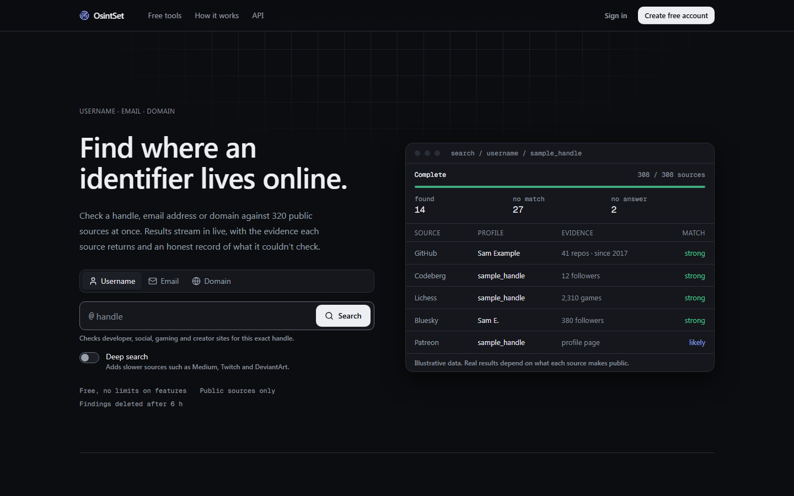
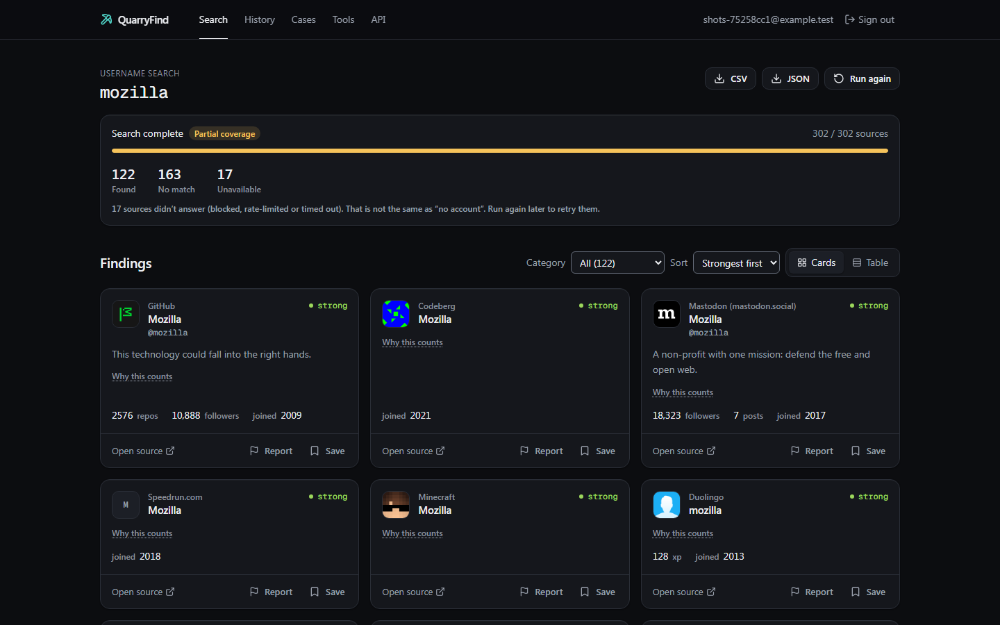
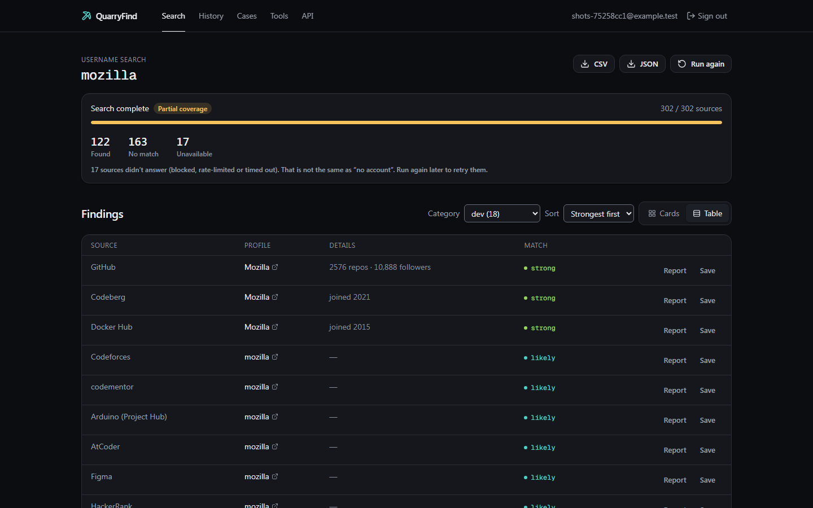
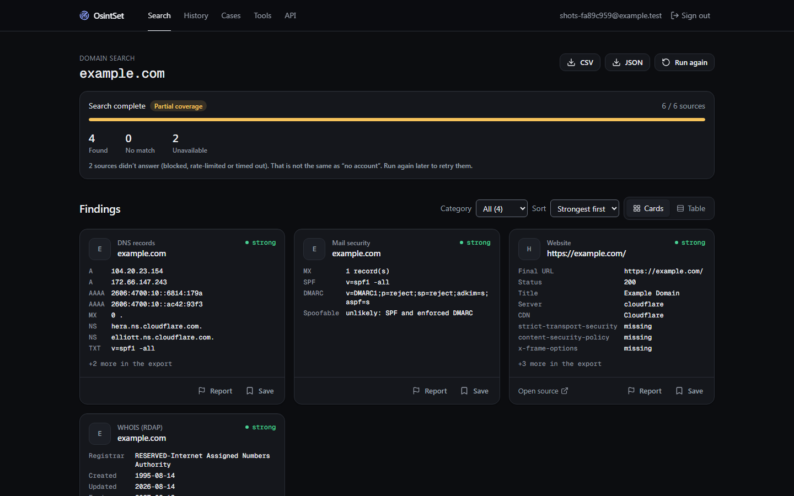
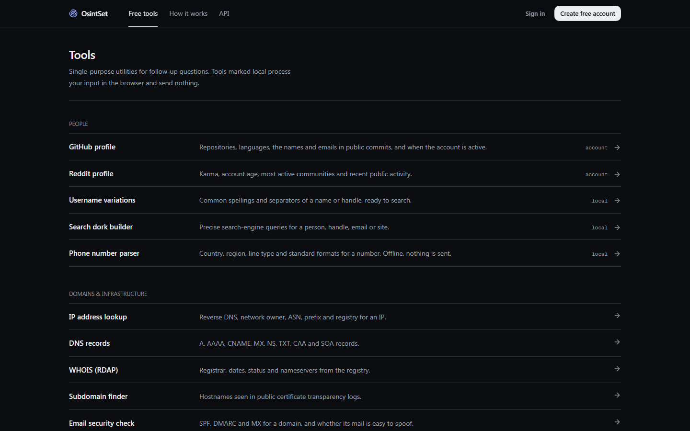
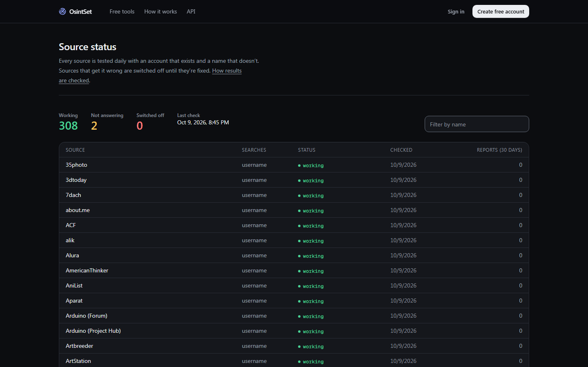
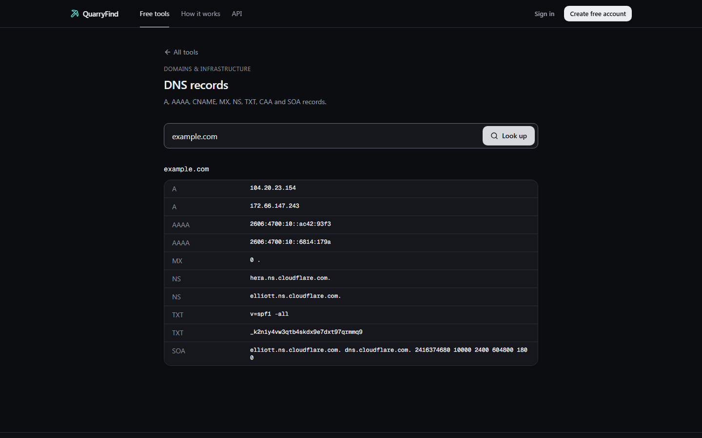
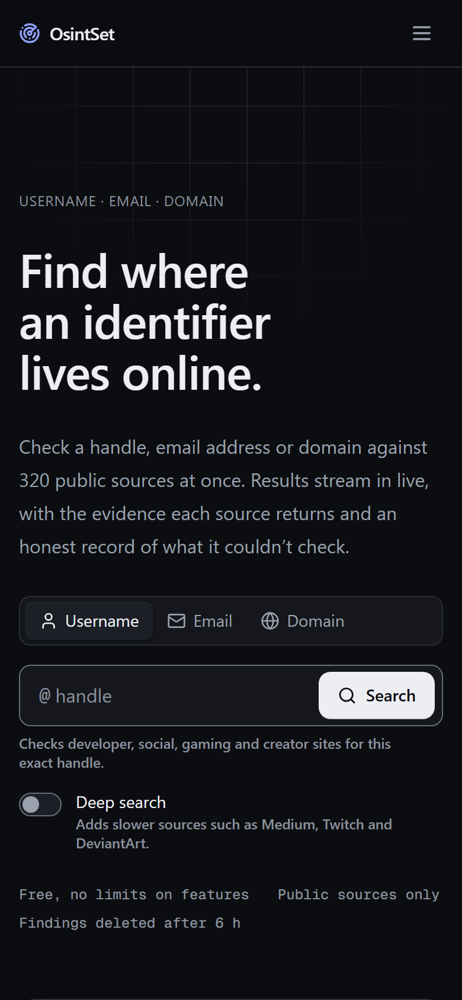

# QuarryFind

[](https://github.com/AkarshSharma2012/OsintSet/actions/workflows/ci.yml) [](https://github.com/AkarshSharma2012/OsintSet/actions/workflows/live-smoke.yml) [](https://github.com/AkarshSharma2012/OsintSet/actions/workflows/module-health.yml)

**Free OSINT search for usernames, email addresses and domains.** Enter one identifier and QuarryFind checks **327 public sources** at once. It streams back every profile it finds, with the evidence for each match and an honest record of which sources didn't answer.

No plans, no credits, no install.

**Live:** https://akarshsharma2012.github.io/OsintSet/ (the in-browser tools work now; search switches on once the backend is connected, see `replica/deploy.md`).



## What it does

- **Username search.** 300+ sites: developer platforms, social networks, gaming, creators and communities. Where the source makes it public, you get the avatar, display name, bio, follower counts and join date, not just a link.
- **Email search.** Public signals only: Gravatar and its verified accounts, Libravatar, public GitHub commit authors, published PGP keys, and the domain's mail setup. The part before the @ is offered as a username lead.
- **Domain search.** WHOIS (RDAP), DNS records, mail security (SPF/DMARC and whether the domain is easy to spoof), subdomains from certificate transparency logs, Wayback Machine history, the website's server, CDN, tech stack and security headers, and its own security.txt and robots.txt (security contacts, hidden paths, blocked crawlers).
- **Honest results.** Every source ends as *found*, *no match* or *didn't answer*. A blocked, rate-limited or timed-out source is never reported as "no account", and bot-check pages never count as a match. Every result has a **"Why this counts"** note explaining the signal that matched.
- **Checked daily.** Each source is tested every day against an account that exists and a name that doesn't. Sources that get it wrong are switched off. The live state of every source is public at `/sources`, and users can **report a wrong result**.
- **Cases.** Save findings into private cases with your notes. Search results are deleted after 6 hours; cases stay until you delete them.
- **History and export.** Re-open any search from the last 90 days, and download findings as CSV (with spreadsheet-formula protection) or JSON.
- **15 free tools.** GitHub and Reddit profiles (activity charts and a timezone guess), IP lookup, DNS, WHOIS, subdomain finder, email security check, archive history, website headers and tech, photo EXIF/GPS reader, username variations, search dork builder, phone number parser, email header analyzer, and hash identifier with a breached-password check. Six of them run entirely in your browser.
- **Free API.** Every account can create API keys. Searches can be async, synchronous (`wait`) or streamed over Server-Sent Events, and there's an OpenAPI spec.

## Screenshots

**Live results.** Cards stream in as each source answers, with coverage counts and "why this counts" on every match:



**Table view**, filtered to developer platforms:



**Domain search** (WHOIS, DNS, mail security, subdomains, archive, web stack):



| Tools | Source status |
| --- | --- |
|  |  |

| DNS tool | Mobile |
| --- | --- |
|  |  |

## How it works

```
browser (static Next.js site)
   │  sign in, read own data ─────────────►  Supabase Postgres (row level security)
   │  POST search-start ─────────────────►  Edge Function: create run, pick sources
   │  POST search-batch × N (4 at a time) ►  Edge Function: run 15 sources, record each
   │  ◄────────────── Realtime + 5 s re-sync: results stream into the page
   └  tools ─────────────────────────────►  Edge Function: IP, DNS, WHOIS, CT logs, …
pg_cron: purge results after 6 h · history after 90 days · close stuck runs
GitHub Action (daily): every source's positive/negative fixture → module_health
```

- **Engine**: `supabase/functions/_shared/engine/`, plain TypeScript using `fetch`. The same code runs in Supabase Edge Functions (Deno), the local dev API and the tests (Node).
- **Batches are driven by the client.** Each batch is an ordinary request with its own CPU budget. Failed batches are retried, and reopening a half-finished search resumes it.
- **Stack** (free tiers): Next.js 15 static export on GitHub Pages, Supabase (Postgres, Auth, Realtime, Edge Functions, pg_cron), Tailwind CSS 4.

## Run it locally

You need **Node 24+**, **Python 3**, and **Docker** for the full stack.

### Option A: quick look, no database

Uses an in-memory dev API with the real engine. Sign-in is a local stand-in.

```bash
npm install && npm --prefix web install
```

```bash
npm run dev:api
```

```bash
npm --prefix web run dev
```

Open http://localhost:3000. Leave `NEXT_PUBLIC_BACKEND` unset in `web/.env.local` for this mode.

### Option B: full stack with Supabase

1. Start Supabase locally. It uses ports 553xx, so it can run next to other projects.

   ```bash
   npx supabase start
   ```

2. Create the env files from `.env.example`, using the values printed by `npx supabase status`:
   - `web/.env.local`: `NEXT_PUBLIC_BACKEND=supabase`, `NEXT_PUBLIC_SUPABASE_URL`, `NEXT_PUBLIC_SUPABASE_ANON_KEY`
   - `supabase/functions/.env`: `ALLOWED_ORIGINS=http://localhost:3000`, plus a random `INTERNAL_SECRET`
   - `.env.test.local` (for tests): `SUPABASE_URL`, `SUPABASE_ANON_KEY`, `SUPABASE_SERVICE_ROLE_KEY`

3. Run the site:

   ```bash
   npm --prefix web run dev
   ```

   Migrations are applied by `supabase start`. The Edge Functions are served automatically at `http://127.0.0.1:55321/functions/v1/`.

4. Optional: fill the source status page.

   ```bash
   npm run fixtures -- --upload
   ```

### Tests

| what | command |
| --- | --- |
| Unit tests (engine, tools, export) | `npx vitest run tests/engine.test.ts tests/client-tools.test.ts tests/auth-errors.test.ts` |
| Security (RLS) + backend integration | `set -a; . ./.env.test.local; set +a; npx vitest run` |
| End-to-end (Playwright, desktop + mobile, axe) | build with `NEXT_DIST_DIR=.next-build npm --prefix web run build`, then `npx playwright test` |
| Live check of every source | `npm run fixtures` |

Current state: 46+ end-to-end tests and 47 unit/integration tests passing.

## API

```bash
curl -N -X POST http://127.0.0.1:55321/functions/v1/v1/searches \
  -H "Authorization: Bearer $OSK_KEY" -H "Content-Type: application/json" \
  -d '{"type":"domain","query":"example.com","stream":true}'
```

Create a key under **Settings → API keys**. The full reference is at `/docs/api/` in the app, and the machine-readable spec is at `GET /v1/openapi.json`.

## Project layout

```
web/                       Next.js app (static export): pages, components, data layer
supabase/migrations/       schema, row level security, pg_cron jobs
supabase/functions/        search-start, search-batch, tools, api-keys, account, v1 (+ _shared/engine)
scripts/                   dev API, fixtures, WhatsMyName import, sources list, screenshots, tokens
tests/  e2e/               Vitest unit/integration, Playwright end-to-end
replica/                   product research, architecture, test plan, bug log, parity report
```

## Responsible use

Only investigate people and organisations you're allowed to. A matching username is a lead, not proof that two accounts belong to the same person. QuarryFind uses public sources only. It never solves CAPTCHAs, never probes sign-up or password-reset pages, never logs in as anyone, and never stores a database of people.

## Credits

- Site checks for 261 sources are derived from **[WhatsMyName](https://github.com/WebBreacher/WhatsMyName)** (© Micah Hoffman, CC BY-SA 4.0). Each was re-tested before inclusion. The derived list (`supabase/functions/_shared/engine/wmn-sites.json`) is shared under the same licence.
- Fonts: [Geist](https://vercel.com/font) (SIL OFL). Icons: [Lucide](https://lucide.dev) (ISC). Phone parsing: [libphonenumber-js](https://github.com/catamphetamine/libphonenumber-js) (MIT). EXIF: [exifr](https://github.com/MikeKovarik/exifr) (MIT).
